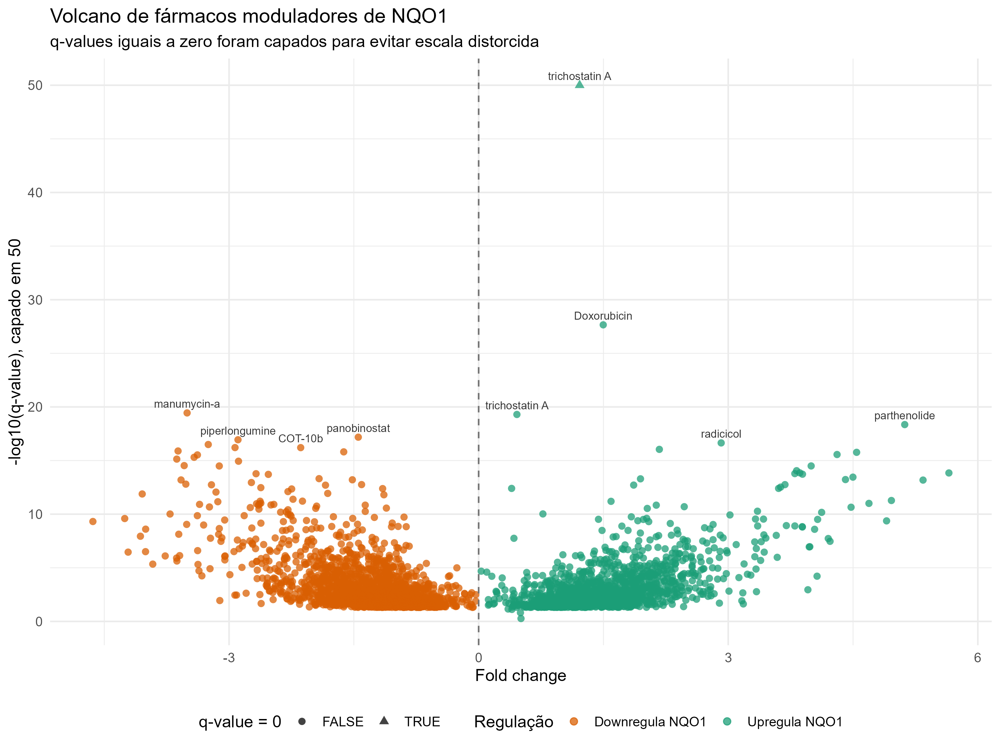
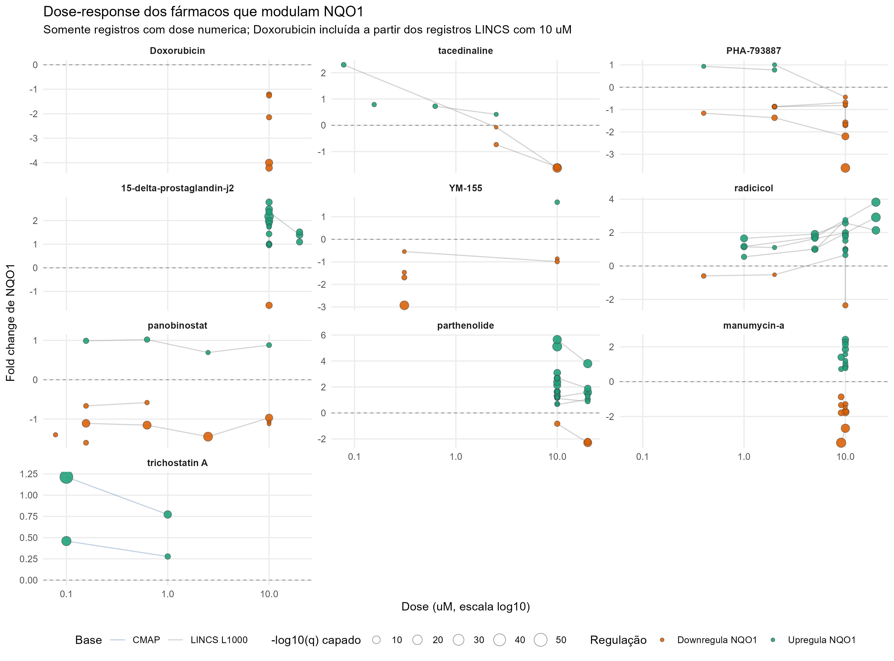
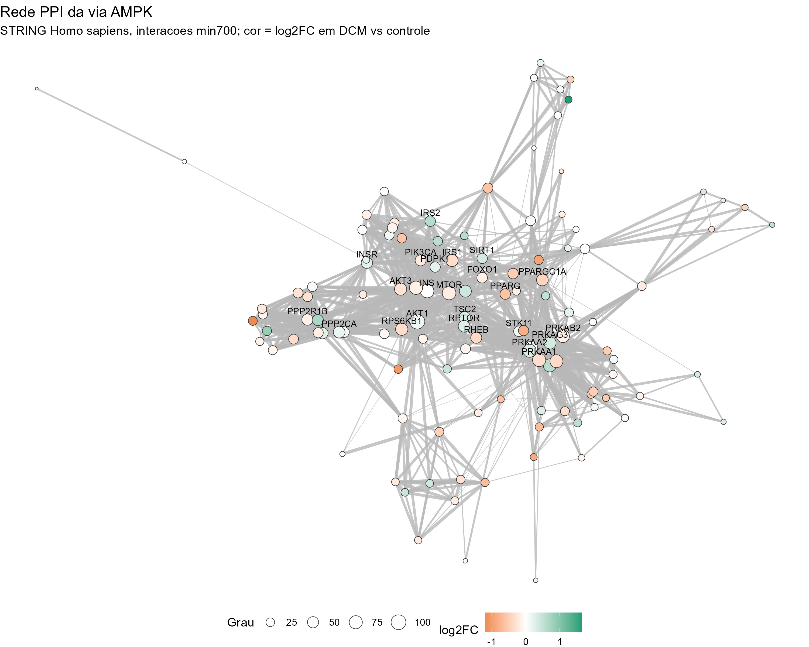
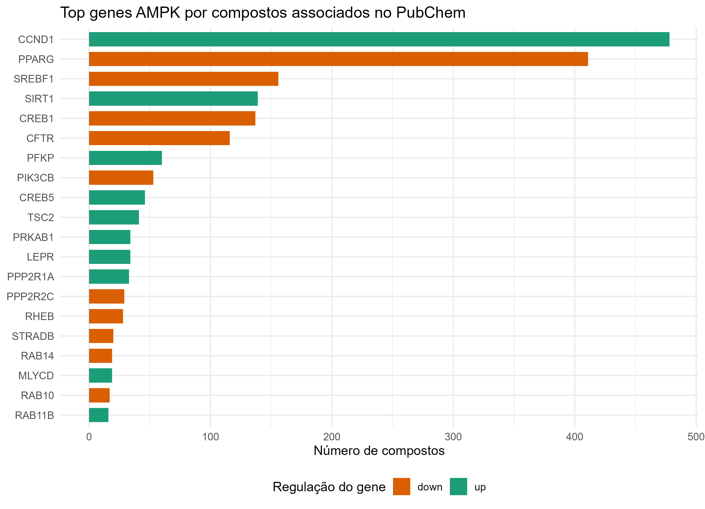

<div align="center">

# Análise integrativa in silico da regulação do NQO1 e da cardiotoxicidade da doxorrubicina na cardiomiopatia dilatada

**Transcriptômica, via AMPK e farmacologia reversa com o Drug Gene Budger (DGB)**

[](https://www.r-project.org/)
[](LICENSE)
[](https://www.ncbi.nlm.nih.gov/geo/query/acc.cgi?acc=GSE116250)
[](RELATORIO_CIENTIFICO.md)

</div>

---

## Visão geral

Estudo **in silico** da regulação do gene **NQO1** (NAD(P)H quinona desidrogenase 1) na
cardiomiopatia dilatada (DCM) e do ranqueamento de fármacos capazes de modular a sua
expressão. O percurso integra três etapas encadeadas:

1. **Via AMPK (KEGG hsa04152)** — caracterização do contexto metabólico e energético da DCM.
2. **Transcriptoma completo (GSE116250)** — seleção do **NQO1** como gene downregulado na DCM.
3. **Drug Gene Budger (DGB)** — farmacologia reversa e identificação da **doxorrubicina** como
   repressor mais significativo do NQO1.

Todo o fluxo é reprodutível a partir de dados públicos secundários. **Não há ensaio
experimental próprio** e o estudo é exploratório, descritivo e gerador de hipótese.

---

## O que significa cada análise

| Análise | O que é | Para que serve neste projeto |
|---|---|---|
| **Expressão diferencial (limma)** | Modelo linear por gene com moderação empírica da variância, ajustado por covariáveis (sexo e idade). | Comparar DCM *versus* controle (CTRL) e produzir log2 Fold Change e p-valor ajustado de cada gene. |
| **DEG (differentially expressed genes)** | Conjunto de genes com expressão significativamente alterada entre os grupos. | Identificar o NQO1 e os genes da via AMPK alterados na DCM (`padj < 0,05`). |
| **Fold Change (log2FC)** | Razão de expressão entre grupos, em escala log2. Valores negativos indicam downregulação. | Quantificar a magnitude e a direção da mudança (ex.: NQO1 com log2FC = −1,686). |
| **GSEA (Gene Set Enrichment Analysis)** | Teste de enriquecimento que avalia se os genes de uma via se concentram nas extremidades do ranking de expressão, sem depender de um corte de significância. | Verificar se a via AMPK como um todo está deslocada na DCM (resultado: não significativa). |
| **GSVA (Gene Set Variation Analysis)** | Método que transforma a expressão gênica em um **escore de enriquecimento por amostra**, permitindo tratar a via como uma variável contínua. | Medir a atividade da via AMPK amostra a amostra e comparar DCM *versus* CTRL por teste estatístico. |
| **Rede PPI (STRING)** | Rede de interações proteína–proteína construída a partir do STRING. | Contextualizar as interações físicas e funcionais entre os genes da via AMPK. |
| **Farmacologia reversa (DGB)** | Abordagem que inverte a direção usual: em vez de perguntar "que genes um fármaco modula", pergunta-se "que fármacos modulam um gene-alvo". | Triar milhares de compostos quanto ao efeito sobre o NQO1, usando CMAP, LINCS L1000 e CREEDS. |
| **PubChem** | Base pública de compostos químicos e bioatividade. | Associar genes da via AMPK a compostos conhecidos e priorizar candidatos farmacológicos. |
| **q-value / padj (FDR)** | p-valor corrigido para comparações múltiplas pelo método de Benjamini–Hochberg. | Controlar falsos positivos na varredura do transcriptoma e no ranking de fármacos. |
| **Score de ranking** | Índice composto `−log10(q) × \|Fold Change\|`. | Ordenar os fármacos por significância estatística e tamanho de efeito combinados. |

---

## Pergunta e fluxo analítico

A pergunta inicial não era sobre um gene específico, mas sobre um **fenômeno clínico**:
quais fármacos contribuem para a cardiomiopatia, em especial por estresse oxidativo e
disfunção metabólica. O desenho segue um funil, da clínica ao alvo molecular e ao fármaco.

```text
Problema clínico (cardiomiopatia e cardiotoxicidade)
        │
        ▼
Passo 1. Via candidata (AMPK, hsa04152) ──► contexto metabólico e energético
        │   Resultado: via não enriquecida, com genes individuais alterados.
        ▼
Passo 2. Transcriptoma completo ─────────► gene NQO1 (redox)
        │   Resultado: alvo molecular com relevância biológica.
        ▼
Passo 3. Drug Gene Budger ───────────────► fármaco modulador: doxorrubicina
            Farmacologia reversa (gene ──► fármaco).
```

### Passo 1 — Via AMPK (KEGG hsa04152)

Análise exploratória da via de sinalização AMPK na DCM, a partir do **GSE116250**
(RNA-seq de miocárdio humano: 14 não-falha, 37 DCM e 13 ICM). A via foi avaliada por
**limma**, **GSEA** e **GSVA** e **não apresentou enriquecimento estatisticamente
significativo**. No GSEA com as 187 vias KEGG, NES = −1,19 e padj = 0,419.

### Passo 2 — Do transcriptoma completo ao NQO1

Análise de todos os genes diferencialmente expressos do GSE116250. O **NQO1** apareceu
**downregulado** na DCM, com log2 Fold Change = −1,686 e padj = 6,86 × 10⁻¹³. A seleção
baseia-se na função citoprotetora e redox do gene. O NQO1 **não pertence à via AMPK**.

### Passo 3 — DGB e a doxorrubicina

Consulta ao **Drug Gene Budger**, que integra CMAP, LINCS L1000 e CREEDS. A
**doxorrubicina** foi o fármaco com resultado mais significativo e evidência em duas
bases independentes: q = 2,21 × 10⁻²⁸, Fold Change médio = −1,065, downregulador, com
15 registros.

> **Nota sobre o ranking.** O trichostatin A aparece com q = 0 por *underflow* numérico
> em fonte única (CMAP), capado em 10⁻⁵⁰. A doxorrubicina tem o menor q-value real do
> ranking e é a única evidência multiplataforma entre os primeiros colocados.

A associação entre doxorrubicina e NQO1 vem de bases de assinatura farmacológica, e não
de ensaio de viabilidade próprio. A hipótese de cardiotoxicidade é **integrativa** e
requer validação experimental.

---

## Resultados-chave

| Etapa | Análise | Métrica | Valor | Interpretação |
|---|---|---|---|---|
| Passo 1 | GSEA da via AMPK | NES / padj | −1,19 / 0,419 | Não significativo |
| Passo 2 | NQO1 no DEG | log2FC / padj | −1,686 / 6,86 × 10⁻¹³ | Downregulado na DCM |
| Passo 3 | Doxorrubicina no DGB | q / FC médio | 2,21 × 10⁻²⁸ / −1,065 | Downregulador, 2 bases |

---

## Figuras

### Análise upstream (DEG e via AMPK)

<p align="center">
  
  
</p>

<p align="center"><em>Figura 1. Volcano da expressão diferencial (DCM vs CTRL) e distribuição do escore GSVA da via AMPK.</em></p>

<p align="center">
  
  
</p>

<p align="center"><em>Figura 2. Enriquecimento GSEA e heatmap dos genes da via AMPK.</em></p>

### Análise downstream (NQO1, DGB, PPI e PubChem)

<p align="center">
  
  
</p>

<p align="center"><em>Figura 3. Volcano e curva dose-resposta dos fármacos que modulam o NQO1.</em></p>

<p align="center">
  
  
</p>

<p align="center"><em>Figura 4. Rede PPI da via AMPK (STRING) e associações PubChem por gene.</em></p>

---

## Estrutura do repositório

```text
nqo1-doxorrubicina-cardiotoxicidade/
├── README.md                                  # Visão geral, glossário e instruções
├── RELATORIO_CIENTIFICO.md                    # Documento científico único do projeto
├── AUDITORIA_DE_DADOS.md                      # Auditoria de integridade dos dados
├── LICENSE                                    # Licença MIT
├── DESCRIPTION                                # Dependências e metadados em R
├── requirements.txt                           # Dependências em Python (análises futuras)
├── config.yaml                                # Limiares analíticos centralizados
├── .gitignore
│
├── analise_nqo1_cardiotoxicidade.R            # Pipeline único: upstream, downstream e auditoria
├── reports/
│   └── CONTROLE_DE_QUALIDADE.qmd              # Relatório de controle de qualidade
│
├── data/
│   └── raw/                                   # Dados brutos (GEO e STRING), sem edição manual
│       ├── GSE116250_rpkm.txt.gz
│       ├── GSE116250_series_matrix.txt.gz
│       ├── GPL16791.soft.gz
│       └── 9606.protein.*.v11.5.*.gz
│
└── output/
    ├── rdata/                                 # Matriz pré-processada
    ├── tables/
    │   ├── ampk/                              # DEG, NQO1, via AMPK, GSEA, GSVA
    │   ├── nqo1/                              # DGB consolidado, ranking e resumos
    │   ├── pubchem/                           # Associações gene–composto
    │   └── ppi/                               # Nós e arestas da rede PPI
    ├── figures/
    │   ├── ampk/                              # Volcano, GSEA, GSVA e heatmaps
    │   ├── nqo1_drug_regulation/              # Volcano e dose-resposta
    │   ├── pubchem/                           # Compostos por gene
    │   └── ppi/                               # Rede PPI
    ├── audit/                                 # Logs e relatórios de auditoria
    └── archive/                               # Resultados antigos preservados
```

---

## Arquivos de saída

### Tabelas (`output/tables/`)

| Arquivo | Conteúdo |
|---|---|
| `ampk/expressao_diferencial_completa.csv` | Tabela completa do DEG (limma) para todos os genes. |
| `ampk/expressao_nqo1_diferencial.csv` | Resultado de expressão diferencial apenas para o NQO1. |
| `ampk/genes_da_via_ampk_kegg.csv` | Genes da via AMPK (KEGG hsa04152). |
| `ampk/expressao_diferencial_via_ampk.csv` | DEG restrito aos genes da via AMPK. |
| `ampk/gsea_via_ampk.csv` | Resultado do GSEA da via AMPK. |
| `ampk/gsea_todas_as_vias_kegg.csv` | Ranking do GSEA para as 187 vias KEGG. |
| `ampk/gsva_via_ampk.csv` | Escore GSVA da via AMPK por amostra. |
| `ampk/metadados_das_amostras.csv` | Metadados das amostras (fenótipo, sexo e idade). |
| `nqo1/dgb_resultados_nqo1_consolidados.csv` | Registros do DGB consolidados e normalizados. |
| `nqo1/ranking_de_farmacos_nqo1.csv` | Ranking completo dos fármacos moduladores do NQO1. |
| `nqo1/top20_farmacos_nqo1.csv` | As 20 primeiras posições do ranking. |
| `nqo1/farmacos_por_plataforma_e_direcao.csv` | Distribuição de fármacos por plataforma e direção. |
| `nqo1/resumo_doxorrubicina_nqo1.csv` | Resumo dos registros da doxorrubicina. |
| `pubchem/pubchem_associacoes_compostos.csv` | Associações gene–composto no PubChem. |
| `pubchem/pubchem_associacoes_compostos_com_nomes.csv` | Idem, com os nomes dos compostos resolvidos. |
| `ppi/ppi_ampk_string_arestas.csv` | Arestas da rede PPI (STRING). |
| `ppi/ppi_ampk_string_nos.csv` | Nós da rede PPI com atributos (grau e log2FC). |

### Figuras (`output/figures/`)

| Arquivo | Conteúdo |
|---|---|
| `ampk/volcano_plot.png` | Volcano da expressão diferencial. |
| `ampk/GSEA_AMPK_enrichment_plot.png` | Curva de enriquecimento GSEA da via AMPK. |
| `ampk/GSVA_AMPK_boxplot.png` | Escore GSVA da via AMPK por grupo. |
| `ampk/heatmap_AMPK_pathway.png` | Heatmap dos genes da via AMPK. |
| `ampk/heatmap_top_DEGs.png` | Heatmap dos principais DEG. |
| `nqo1_drug_regulation/volcano_farmacos_nqo1.png` | Volcano dos fármacos moduladores do NQO1. |
| `nqo1_drug_regulation/curva_dose_resposta_farmacos_nqo1.png` | Curva dose-resposta dos fármacos. |
| `pubchem/pubchem_compostos_por_gene.png` | Compostos PubChem por gene. |
| `ppi/rede_ppi_ampk.png` | Rede PPI da via AMPK. |

### Auditoria (`output/audit/`)

| Arquivo | Conteúdo |
|---|---|
| `auditoria_de_dados_resumo.txt` | Resumo da auditoria de dados. |
| `eventos_de_auditoria.csv` | Log estruturado de eventos (data, nível, etapa e mensagem). |
| `relatorio_nqo1_pubchem_ppi.md` | Relatório consolidado do NQO1, PubChem e PPI. |
| `logs/execucao_AAAAMMDD.log` | Log de execução do pipeline. |

---

## Como executar

### 1. Dependências em R

```r
install.packages(c("dplyr", "ggplot2", "stringr", "openxlsx", "igraph",
                   "tidyr", "data.table", "readr", "yaml"))

if (!requireNamespace("BiocManager", quietly = TRUE)) install.packages("BiocManager")
BiocManager::install(c("limma", "edgeR", "GSVA", "fgsea", "GEOquery"))
```

As dependências também estão declaradas em [`DESCRIPTION`](DESCRIPTION).

### 2. Pipeline analítico

```powershell
# Pipeline completo: upstream, downstream e auditoria.
& 'C:\Program Files\R\R-4.6.0\bin\Rscript.exe' analise_nqo1_cardiotoxicidade.R
```

### 3. Relatório de controle de qualidade

```powershell
quarto render reports/CONTROLE_DE_QUALIDADE.qmd
```

### 4. Consulta externa ao PubChem (opcional)

Os resultados PubChem são lidos dos CSVs já salvos. Para refazer a consulta externa,
defina as variáveis de ambiente `RUN_PUBCHEM_QUERY` e `NCBI_API_KEY`. A chave **nunca**
deve ser escrita no código.

---

## Controle de qualidade e auditoria

- O pipeline registra data e hora, nível (`INFO`, `WARN` ou `ERROR`) e a etapa em `output/audit/logs`.
- A auditoria de dados gera `output/audit/auditoria_de_dados_resumo.txt` e `output/audit/eventos_de_auditoria.csv`.
- O relatório de integridade de dados está em [`AUDITORIA_DE_DADOS.md`](AUDITORIA_DE_DADOS.md).

---

## Documentação

| Documento | Conteúdo |
|---|---|
| [`RELATORIO_CIENTIFICO.md`](RELATORIO_CIENTIFICO.md) | Narrativa, justificativa científica, implicações clínicas e de enfermagem e análises futuras. |
| [`AUDITORIA_DE_DADOS.md`](AUDITORIA_DE_DADOS.md) | Auditoria de integridade e reprodutibilidade dos dados. |
| [`config.yaml`](config.yaml) | Limiares analíticos centralizados. |
| [`DESCRIPTION`](DESCRIPTION) | Dependências e metadados em R. |
| [`requirements.txt`](requirements.txt) | Dependências em Python para as análises futuras. |
| [`LICENSE`](LICENSE) | Licença MIT. |

---

## Dados e citação

- **GSE116250** (Sweet et al.): RNA-seq de miocárdio humano (DCM, ICM e não-falha), GEO/NCBI.
- **STRING v11.5** (Szklarczyk et al.): rede de interações proteína–proteína.
- **CMAP** (Lamb et al., 2006), **LINCS L1000** (Subramanian et al., 2017) e **CREEDS**.
- **Drug Gene Budger** (Wang et al., *Bioinformatics*, 2021): farmacologia reversa.

---

## Declaração de transparência algorítmica

> Este projeto utilizou a ferramenta de Inteligência Artificial generativa **deepseek-v4-pro**
> para auxiliar na automação de tarefas repetitivas de codificação (*scripting*), na
> estruturação e correção sintática da documentação, bem como na geração de rotinas de
> auditoria de dados. O uso desta ferramenta está em conformidade com a Portaria CNPq
> nº 2.664/2026, que regulamenta o uso de IA em pesquisas financiadas pela agência,
> garantindo a revisão crítica e a validação final por um pesquisador titular (humano)
> responsável pelos resultados.

---

## Licença

Distribuído sob a **Licença MIT**. Consulte o arquivo [`LICENSE`](LICENSE) para os termos
completos.

Copyright (c) 2026 L. P. Souza, R. P. Santos, P. A. Borges.
