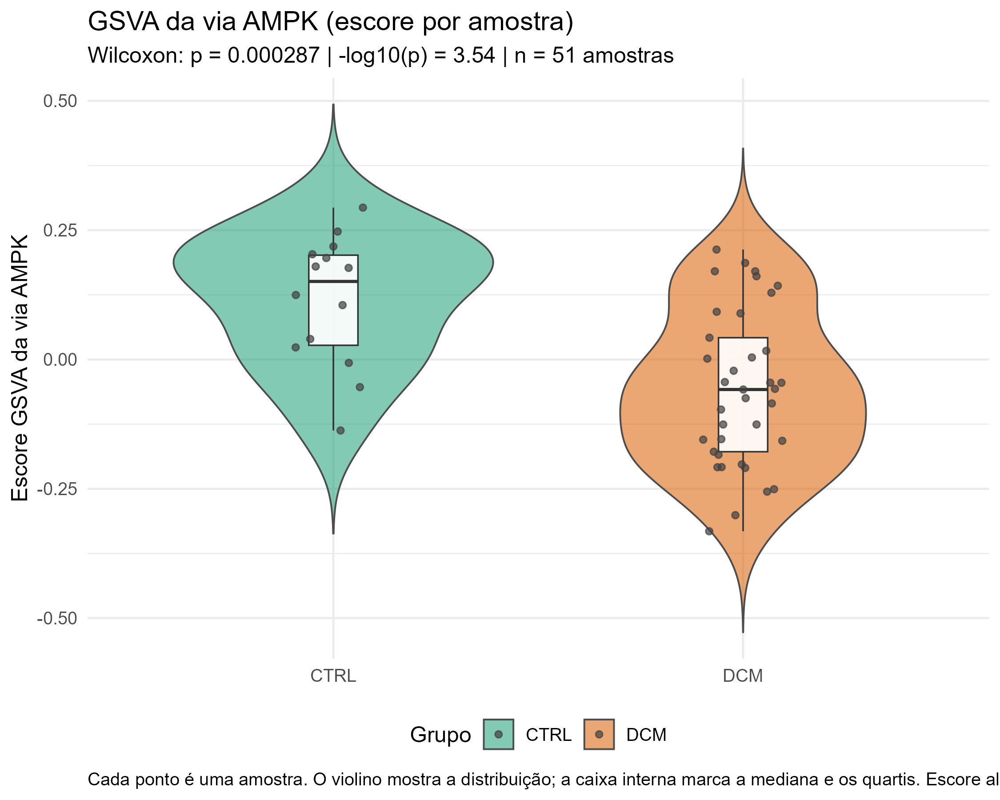

<div align="center">

# NQO1 e doxorrubicina na cardiomiopatia dilatada

**Um estudo in silico com transcriptoma público, via AMPK e farmacologia reversa**

[](https://www.r-project.org/)
[](https://github.com/lucielesilva/nqo1-doxorrubicina-cardiotoxicidade/actions/workflows/r.yml)
[](LICENSE)
[](https://www.ncbi.nlm.nih.gov/geo/query/acc.cgi?acc=GSE116250)
[](RELATORIO_CIENTIFICO.md)

</div>

---

## O que é este projeto

Este repositório guarda o código, as tabelas e as figuras de um estudo feito apenas com dados públicos. A pergunta central é simples: **como a doxorrubicina prejudica o coração?**

Seguimos uma pista molecular. O gene **NQO1** aparece reduzido na cardiomiopatia dilatada (DCM). A doxorrubicina também reduz o NQO1. Isso sugere uma ligação entre o remédio, a defesa antioxidante do coração e a doença.

Não houve experimento de bancada. Tudo foi feito no computador. O resultado serve para levantar hipóteses e orientar estudos futuros.

---

## A pergunta

A doxorrubicina é um quimioterápico eficaz, mas pode lesionar o coração. A cardiomiopatia dilatada entra como contexto: o coração dilatado e fraco já tem alterações metabólicas e de estresse oxidativo.

A pergunta do estudo é:

> Existe um gene ou uma via que ajude a ligar doxorrubicina, estresse oxidativo e cardiomiopatia dilatada?

O percurso do estudo passou por **AMPK**, chegou ao **NQO1** e terminou na **doxorrubicina**.

---

## Resposta curta

| O que olhamos | O que apareceu |
|---|---|
| **Via AMPK** | A via não aparece enriquecida como um todo. Alguns genes isolados estão alterados, mas o conjunto não passa do corte estatístico. |
| **Gene NQO1** | Está **reduzido** na DCM (downregulado): log2 Fold Change = −1,686 e padj = 6,86 × 10⁻¹³. |
| **Doxorrubicina** | É o fármaco com maior sinal de repressão do NQO1: q = 2,21 × 10⁻²⁸, Fold Change médio = −1,065. O efeito aparece em duas bases independentes. |

Em uma frase: **a doxorrubicina reduz um gene que protege o coração do estresse oxidativo, e esse gene já está reduzido na cardiomiopatia dilatada.**

## Por que isso importa

O NQO1 ajuda a célula a lidar com quinonas e radicais livres. Quando ele cai, a defesa antioxidante do coração fica menor. A doxorrubicina produz estresse oxidativo. A hipótese do estudo é que o remédio reduza o NQO1 e deixe o coração mais vulnerável.

Isso não prova que a doxorrubicina causa cardiotoxicidade por essa via. Mostra um caminho plausível para testar.

---

## Como a análise foi montada

O estudo segue três passos. Cada um responde a uma pergunta menor.

### Passo 1 — A via AMPK está alterada na DCM?

Usamos 64 amostras de miocárdio do projeto público **GSE116250**: 14 sem falha, 37 com DCM e 13 com cardiomiopatia isquêmica (ICM).

Comparamos DCM com controle usando **limma**, **GSEA** e **GSVA**. A via AMPK não se mostrou enriquecida como conjunto. O resultado da AMPK no GSEA com as 187 vias KEGG foi NES = −1,19 e padj = 0,419. No teste por amostra, DCM teve escore GSVA mediano menor que o controle (p = 0,00029), mas a diferença é modesta e não muda a conclusão do GSEA.

Conclusão do passo: a AMPK não é o centro da história, embora tenha genes alterados.

### Passo 2 — Qual gene merece atenção no transcriptoma completo?

Em vez de olhar só a via AMPK, analisamos todos os genes do GSE116250. O modelo foi ajustado por sexo e idade.

O **NQO1** apareceu entre os genes mais significativos, com expressão menor na DCM. Em escala simples, log2FC = −1,686 significa cerca de 3,2 vezes menos NQO1 na DCM. A escolha faz sentido biológico: o NQO1 é uma enzima antioxidante que ajuda a detoxificar quinonas.

O NQO1 **não pertence à via AMPK**. Ele entrou no estudo pela análise do transcriptoma completo, não por filtragem da via.

### Passo 3 — Existe fármaco que mexe no NQO1?

Consultamos o **Drug Gene Budger (DGB)**, que reúne assinaturas farmacológicas do CMAP, LINCS L1000 e CREEDS. A pergunta é invertida: em vez de perguntar o que um fármaco faz, perguntamos quais fármacos mudam a expressão do NQO1.

A **doxorrubicina** foi o resultado mais consistente. Ela reduz o NQO1 e aparece em duas bases independentes, com 15 registros.

> **Sobre o ranking.** O trichostatin A aparece com q = 0 por underflow numérico em uma única base (CMAP), capado em 10⁻⁵⁰. A doxorrubicina tem o menor q-value real do ranking e é a única evidência multiplataforma entre os primeiros colocados.

A ligação entre doxorrubicina e NQO1 vem de bancos de assinatura farmacológica. Não é um teste de viabilidade celular feito por nós. A hipótese de cardiotoxicidade é integrativa e precisa de validação experimental.

---

## Figuras

### Via AMPK e expressão diferencial

<p align="center">
  
  
</p>

<p align="center"><em>Figura 1. Volcano da expressão diferencial (DCM vs controle) e violino do escore GSVA da via AMPK. Cada ponto é uma amostra; a caixa interna mostra mediana e quartis.</em></p>

<p align="center">
  
  
</p>

<p align="center"><em>Figura 2. Enriquecimento GSEA e heatmap dos genes da via AMPK.</em></p>

### NQO1, fármacos e redes

<p align="center">
  
  
</p>

<p align="center"><em>Figura 3. Volcano e curva dose-resposta dos fármacos que modulam o NQO1.</em></p>

<p align="center">
  
  
</p>

<p align="center"><em>Figura 4. Rede PPI da via AMPK (STRING) e associações PubChem por gene.</em></p>


<p align="center"><em>Figura 5. Escores xCell por tipo celular. O violino mostra a distribuição; a caixa interna marca mediana e quartis. A ICM entra como contexto, mas os testes comparam DCM com controle.</em></p>

---

## O que cada análise faz

| Análise | Explicação curta | Para que usamos |
|---|---|---|
| **limma** | Modelo linear que compara grupos gene por gene, com ajuste para sexo e idade. | Encontrar genes diferentes entre DCM e controle. |
| **DEG** | Lista de genes com mudança estatisticamente significativa. | Destacar o NQO1 e outros genes alterados. |
| **log2 Fold Change** | Tamanho da mudança em escala log2. Valor negativo indica expressão menor. | Mostrar a direção e a força da alteração. |
| **GSEA** | Verifica se os genes de uma via se acumulam nas pontas do ranking de expressão. | Testar a via AMPK como conjunto, sem corte de p-valor. |
| **GSVA** | Transforma a via em um escore por amostra. | Comparar a atividade da via entre amostras e grupos. |
| **Rede PPI** | Mapa de interações proteína–proteína do STRING. | Ver como os genes da via AMPK se conectam. |
| **Farmacologia reversa** | Parte do gene e procura fármacos que mudam sua expressão. | Triar compostos que podem modular o NQO1. |
| **PubChem** | Base pública de compostos e bioatividade. | Associar genes da via AMPK a compostos conhecidos. |
| **xCell** | Estima escores de tipos celulares a partir da expressão bulk. | Ver se a mistura de células muda entre os grupos. |
| **SVA** | Estima fatores técnicos ocultos na matriz de expressão. | Testar se o efeito do NQO1 resiste a possíveis lotes. |
| **q-value / padj** | p-valor corrigido para comparações múltiplas por Benjamini–Hochberg. | Reduzir falsos positivos. |

---

## Como rodar

### Dependências em R

```r
install.packages(c("dplyr", "ggplot2", "stringr", "openxlsx", "igraph",
                   "tidyr", "data.table", "readr", "yaml", "pheatmap",
                   "httr", "jsonlite", "ggrepel", "magick"))

if (!requireNamespace("BiocManager", quietly = TRUE)) install.packages("BiocManager")
BiocManager::install(c("limma", "edgeR", "GSVA", "fgsea", "GEOquery", "sva"))
```

O xCell é instalado pelo GitHub:

```r
remotes::install_github("dviraran/xCell")
```

As dependências também estão em [`DESCRIPTION`](DESCRIPTION).

### Pipeline principal

```powershell
Rscript analise_nqo1_cardiotoxicidade.R
```

No Windows, use o caminho completo do Rscript se ele não estiver no PATH:

```powershell
& 'C:\Program Files\R\R-4.6.1\bin\Rscript.exe' analise_nqo1_cardiotoxicidade.R
```

### Tutoriais passo a passo

```powershell
Rscript executar_tutoriais.R
```

Os scripts em `tutoriais/` vão do preparo dos dados (00) até SVA e xCell (06). O script 07 é opcional e faz a análise de rede e vias.

### Análise de rede e vias (opcional)

```powershell
Rscript tutoriais/07_PPI_NQO1_string_kegg_reactome.R
```

Para forçar uma nova consulta ao STRING, KEGG e Reactome:

```powershell
$env:NQO1_REFRESH="1"; Rscript tutoriais/07_PPI_NQO1_string_kegg_reactome.R
```


### Relatório de controle de qualidade

```powershell
quarto render reports/CONTROLE_DE_QUALIDADE.qmd
```

O relatório agora usa violinos para mostrar a distribuição da expressão antes e depois da normalização.

### Consulta externa ao PubChem

Os resultados do PubChem já estão salvos em CSV. Para refazer a consulta, defina as variáveis `RUN_PUBCHEM_QUERY` e `NCBI_API_KEY`. A chave nunca deve ser escrita no código.

---

## Estrutura do repositório

```text
nqo1-doxorrubicina-cardiotoxicidade/
├── README.md
├── RELATORIO_CIENTIFICO.md                 # Relatório científico completo
├── AUDITORIA_DE_DADOS.md                   # Integridade e reprodutibilidade
├── analise_nqo1_cardiotoxicidade.R         # Pipeline completo
├── executar_tutoriais.R                    # Executa os scripts 01 a 06
├── config.yaml                             # Limiares e parâmetros
├── DESCRIPTION
│
├── tutoriais/
│   ├── 00_configuracao_e_dados.R
│   ├── 01_UMAP.R
│   ├── 02_volcano.R
│   ├── 03_gene_sets.R
│   ├── 04_rede_PPI.R
│   ├── 05_extras_GSEA_GSVA.R
│   ├── 06_batch_deconvolution.R
│   ├── 07_PPI_NQO1_string_kegg_reactome.R   # Rede NQO1 + KEGG/Reactome (opcional)
│   └── LEIA-ME.md
│
├── reports/
│   └── CONTROLE_DE_QUALIDADE.qmd
│
├── data/
│   ├── raw/                                # GEO e STRING, sem edição manual
│   └── processed/                          # Objetos .rds prontos
│
└── output/
    ├── tables/                             # CSVs por análise
    ├── figures/                            # Figuras em PNG
    ├── audit/                              # Logs e relatórios de auditoria
    └── archive/                            # Resultados antigos preservados
```

---

## Saídas principais

### Tabelas

| Arquivo | Conteúdo |
|---|---|
| `output/tables/ampk/expressao_diferencial_completa.csv` | Resultado do limma para todos os genes. |
| `output/tables/ampk/expressao_nqo1_diferencial.csv` | Resultado apenas do NQO1. |
| `output/tables/ampk/gsea_via_ampk.csv` | GSEA da via AMPK. |
| `output/tables/ampk/gsea_todas_as_vias_kegg.csv` | Ranking das 187 vias KEGG. |
| `output/tables/ampk/gsva_via_ampk.csv` | Escore GSVA por amostra. |
| `output/tables/nqo1/ranking_de_farmacos_nqo1.csv` | Ranking dos fármacos que modulam o NQO1. |
| `output/tables/nqo1/resumo_doxorrubicina_nqo1.csv` | Registros da doxorrubicina. |
| `output/tables/xCell_scores.csv` | Escores de tipos celulares por amostra. |
| `output/tables/xCell_teste.csv` | Testes DCM vs controle para cada tipo celular. |

A lista completa fica em `output/tables/`.

### Figuras

| Arquivo | Conteúdo |
|---|---|
| `ampk/volcano_plot.png` | Volcano da expressão diferencial. |
| `ampk/GSVA_AMPK_violino.png` | Violino do escore GSVA da via AMPK. |
| `ampk/GSEA_AMPK_enrichment_plot.png` | Curva de enriquecimento GSEA. |
| `ampk/heatmap_AMPK_pathway.png` | Heatmap dos genes da via AMPK. |
| `nqo1_drug_regulation/volcano_farmacos_nqo1.png` | Volcano dos fármacos moduladores do NQO1. |
| `nqo1_drug_regulation/curva_dose_resposta_farmacos_nqo1.png` | Curva dose-resposta dos fármacos. |
| `ppi/rede_ppi_ampk.png` | Rede PPI da via AMPK. |
| `pubchem/pubchem_compostos_por_gene.png` | Compostos PubChem por gene. |
| `xCell_violinos.png` | Violinos dos escores xCell por grupo. |
| `xCell_heatmap.png` | Heatmap dos escores xCell por amostra. |

As figuras de distribuição usam violino com caixa interna. O violino mostra a forma da distribuição; a caixa marca mediana e quartis.

---

## Limites do estudo

- É um estudo **in silico**. Não houve experimento próprio.
- Os resultados mostram associação e geram hipótese. Não provam causalidade.
- A ligação doxorrubicina–NQO1 vem de bancos de assinatura farmacológica.
- Os escores xCell são relativos. Não devem ser lidos como frações absolutas de células.
- O achado precisa de validação em coorte independente e, depois, em modelo experimental.

Esses limites estão discutidos com mais detalhe no [`RELATORIO_CIENTIFICO.md`](RELATORIO_CIENTIFICO.md).

---

## Controle de qualidade

- O pipeline registra data, hora, nível (`INFO`, `WARN`, `ERROR`) e etapa em `output/audit/logs`.
- A auditoria gera `output/audit/auditoria_de_dados_resumo.txt` e `output/audit/eventos_de_auditoria.csv`.
- O relatório de integridade está em [`AUDITORIA_DE_DADOS.md`](AUDITORIA_DE_DADOS.md).
- O controle de qualidade da expressão está em `reports/CONTROLE_DE_QUALIDADE.qmd`.

---

## Dados e referências

- **GSE116250** (Sweet et al.): RNA-seq de miocárdio humano com DCM, ICM e amostras sem falha. Disponível no GEO/NCBI.
- **STRING v11.5** (Szklarczyk et al.): rede de interações proteína–proteína.
- **CMAP** (Lamb et al., 2006), **LINCS L1000** (Subramanian et al., 2017) e **CREEDS**.
- **Drug Gene Budger** (Wang et al., *Bioinformatics*, 2021): farmacologia reversa.
- **limma** (Ritchie et al., 2015): modelo linear para microarranjos e RNA-seq.
- **Kong et al. (2022)**: estresse oxidativo e morte celular na cardiotoxicidade aguda por doxorrubicina.
- **Gajjar et al. (2026)**: estratificação de risco cardiovascular e vigilância em cardio-oncologia.
- **Rodrigues De Souza et al. (2025)**: modelo integrado de multioptose para alvos terapêuticos.


---

## Uso de IA

A ferramenta de IA generativa **deepseek-v4-pro** foi usada para ajudar na automação de tarefas de programação, na organização da documentação e na criação de rotinas de auditoria. A revisão crítica, a validação dos resultados e a decisão final ficaram com os autores humanos.

---

## Licença

Distribuído sob a **Licença MIT**. Veja [`LICENSE`](LICENSE).

Copyright (c) 2026 L. P. Souza, R. P. Santos, P. A. Borges.
