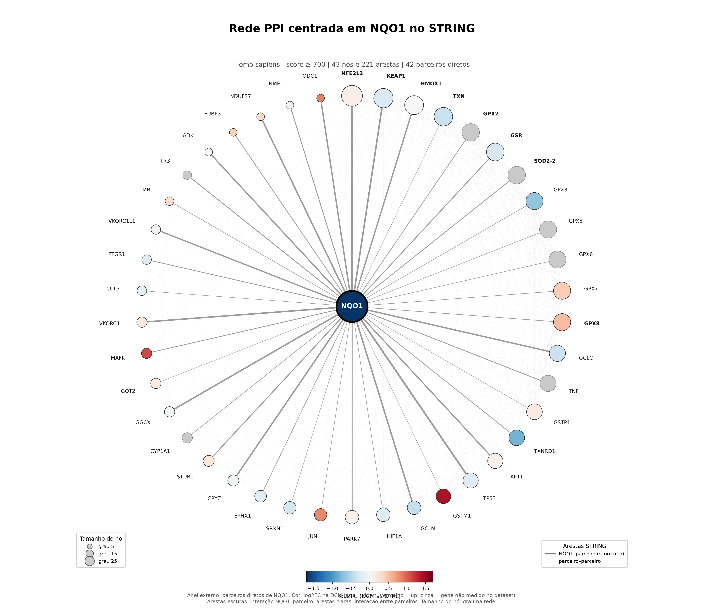
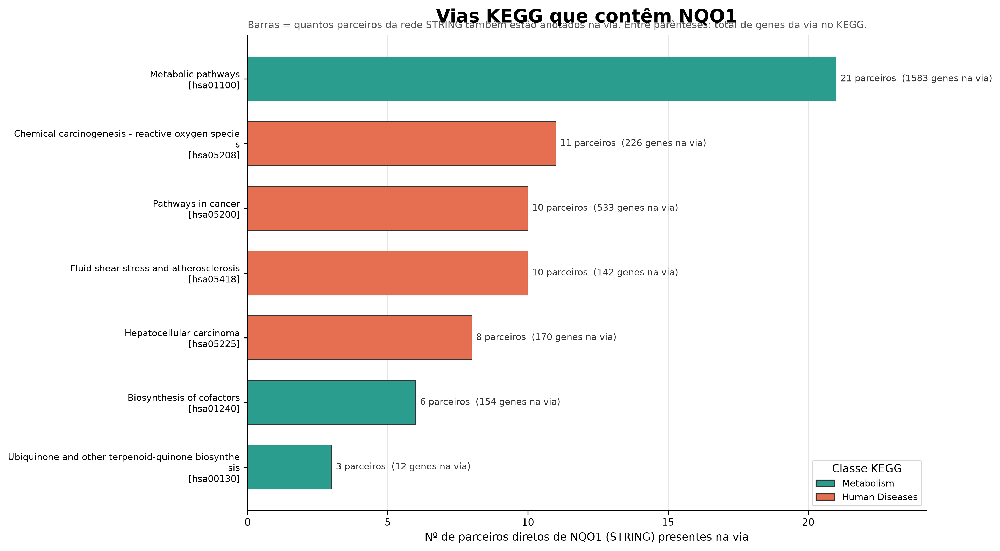
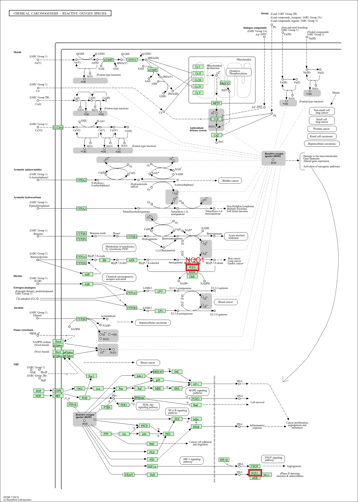
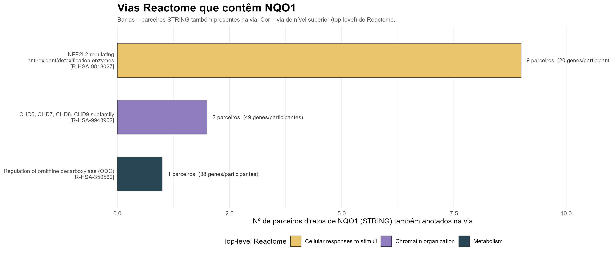
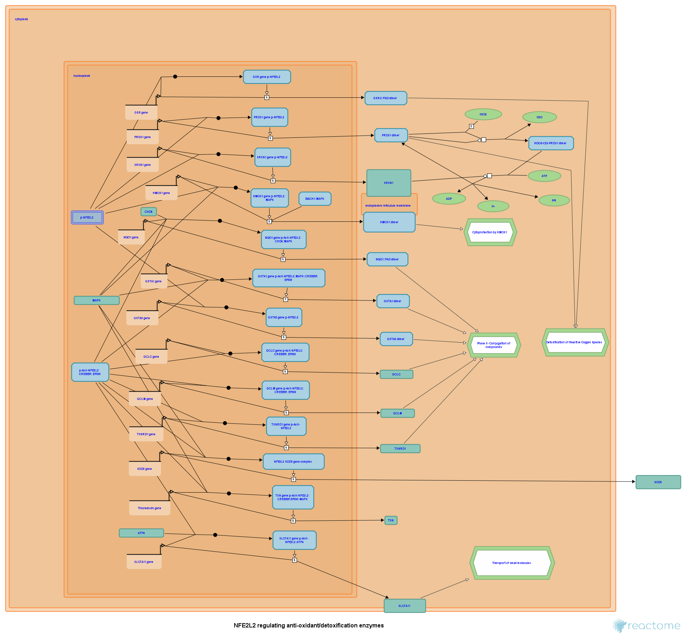
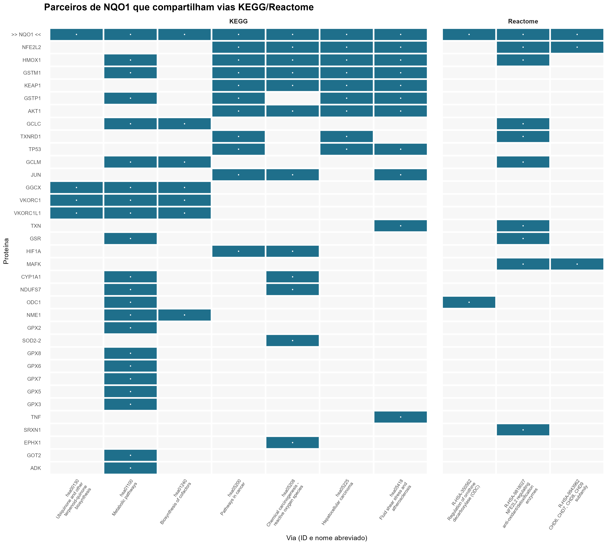

# Análise integrativa in silico da regulação do NQO1 e da cardiotoxicidade da doxorrubicina na cardiomiopatia dilatada

Documento único do projeto. Reúne a narrativa do estudo, a justificativa científica, o contexto de rede e vias, as implicações clínicas e de enfermagem e o plano de análises futuras.

Todo o fluxo e in silico, com dados públicos secundários. Não há ensaio experimental próprio.

---

## 1. Resumo

O estudo investiga a regulação do gene NQO1 (NAD(P)H quinona desidrogenase 1) na cardiomiopatia dilatada (DCM) e identifica fármacos capazes de modular sua expressão. A abordagem e exploratória, descritiva e geradora de hipótese.

O percurso tem três passos encadeados:

1. Análise exploratória da via AMPK (KEGG hsa04152), que não apresentou enriquecimento estatisticamente significativo.
2. Expressão diferencial do transcriptoma completo do GSE116250, que identificou o NQO1 como gene downregulado na DCM.
3. Consulta ao Drug Gene Budger (DGB), que apontou a doxorrubicina como o repressor mais significativo entre os fármacos avaliados.

Além desses três passos, o NQO1 foi contextualizado em uma rede de interações proteína-proteína (STRING) e em vias KEGG e Reactome (seção 4).

O resultado e uma hipótese mecanística sobre estresse oxidativo e cardiotoxicidade por antraciclinas. O estudo não estabelece causalidade nem recomenda conduta clínica.

---

## 2. Fluxo lógico do estudo

### 2.1 Passo 1: caracterização da via AMPK

A investigação comecou pela via de sinalização AMPK (KEGG hsa04152) no miocárdio com cardiomiopatia dilatada. A fonte foi o dataset GSE116250 (RNA-seq, 64 amostras: 14 não-falha, 37 DCM e 13 ICM). A via foi avaliada por expressão diferencial (limma), GSEA e GSVA e não apresentou enriquecimento estatisticamente significativo. O melhor ajuste observado no GSEA com as 187 vias KEGG foi NES = -1,19 e padj = 0,419.

### 2.2 Passo 2: seleção do NQO1

Em seguida foram considerados todos os genes diferencialmente expressos do transcriptoma completo do GSE116250. O NQO1 (NAD(P)H quinona desidrogenase 1) apareceu entre os genes com maior significância estatística, downregulado na DCM com log2 Fold Change = -1,686 e padj = 6,86 x 10^-13.

A seleção do NQO1 se justifica por três critérios:

- Significância estatística entre os genes do dataset.
- Relevância biológica, por ser uma flavoproteina citoprotetora que reduz quinonas e evita a formação de especies reativas de oxigenio (ROS).
- Relevância farmacológica, por participar do metabolismo de quinonas, classe a que pertencem as antraciclinas.

O NQO1 não pertence a via AMPK. Ele foi selecionado a partir do transcriptoma completo, pela função redox, e não por filtragem da via AMPK.

### 2.3 Passo 3: identificação da doxorrubicina pelo DGB

Com o alvo NQO1 definido, foi consultada a plataforma Drug Gene Budger (DGB), que integra as bases CMAP, LINCS L1000 e CREEDS. O fármaco com resultado mais significativo e evidência em duas bases independentes foi a doxorrubicina: q = 2,21 x 10^-28, Fold Change médio = -1,065, downregulador, presente em CREEDS e LINCS L1000, com 15 registros.

### 2.4 Nota sobre o ranking

O trichostatin A aparece com q = 0, valor decorrente de underflow numérico em uma única fonte (CMAP) e capado em 10^-50. A doxorrubicina corresponde ao fármaco com o menor q-value real do ranking e ao único do topo com replicação em mais de uma plataforma independente.

---

## 3. Justificativa científica do desenho

### 3.1 Pergunta de pesquisa

A pergunta inicial não era sobre um gene ou fármaco específico, mas sobre um fenomeno clínico: quais fármacos contribuem para a cardiomiopatia, em especial por mecanismos de estresse oxidativo e disfunção metabólica. Essa formulação e exploratória e geradora de hipótese. Parte de um problema clínico e usa bioinformática para triar candidatos moleculares e farmacológicos, em vez de testar uma hipótese única e fechada.

### 3.2 Desenho em funil

O estudo reduz a pergunta ampla a um alvo molecular e, dele, a um fármaco:

```
Problema clínico (cardiomiopatia e cardiotoxicidade)
        |
        v
Passo 1. Via candidata (AMPK, hsa04152) -> contexto metabólico e energético
        |   Resultado: via não enriquecida, com genes individuais alterados.
        v
Passo 2. Transcriptoma completo -> gene NQO1 (redox)
        |   Resultado: alvo molecular com relevância biológica.
        v
Passo 3. Drug Gene Budger -> fármaco modulador, a doxorrubicina
            Farmacologia reversa (gene -> fármaco).
```

O desenho combina duas estrategias:

- Dirigida por hipótese (via candidata): parte do conhecimento prévio sobre a AMPK como sensor energético cardíaco. Produz o contexto metabólico e refuta a hipótese de via.
- Dirigida por dados (transcriptoma completo): varre todo o transcriptoma sem viés prévio. Produz o NQO1 como gene mais desregulado.

### 3.3 Por que iniciar pela via AMPK

A AMPK é o sensor energético da célula e tem papel central no miocárdio:

1. Homeostase energética cardíaca. O coração tem alta demanda metabólica contínua, e a AMPK coordena captação de glicose, oxidação de ácidos graxos, biogênese mitocondrial e autofagia (Herzig e Shaw, 2018).
2. A cardiomiopatia dilatada envolve remodelamento metabólico. No coração insuficiente há deficit energético, disfunção mitocondrial e acúmulo de estresse oxidativo (Bozkurt et al., 2021).
3. A AMPK é, portanto, o ponto de partida natural para uma investigação de cardiomiopatia com foco metabólico.

### 3.4 Valor do resultado negativo da AMPK

A via AMPK como um todo não está enriquecida de forma significativa, ainda que genes individuais estejam desregulados. Esse resultado tem valor próprio:

1. Refuta uma hipótese plausível: a DCM não e dirigida por um deslocamento coordenado da via AMPK.
2. Redireciona a investigação: se a via inteira não muda, o sinal relevante está em genes isolados, o que justifica a varredura do transcriptoma completo.
3. Evita viés de confirmação, pois o estudo não força a via AMPK a aparecer como significativa.

### 3.5 Seleção do NQO1

Do transcriptoma completo, o NQO1 emergiu como gene downregulado na DCM (log2FC = -1,686; padj = 6,86 x 10^-13). A escolha combina significância estatística, relevância biológica e relevância farmacológica, conforme descrito na seção 2.2. A distinção metodológica importante e que o gene não pertence a via AMPK e foi selecionado pela abordagem dirigida por dados.

### 3.6 Farmacologia reversa com o DGB

Com o alvo NQO1 definido, a consulta ao DGB inverte a direção usual da farmacologia:

- Direção convencional (fármaco para gene): dado um fármaco, quais genes ele modula.
- Direção reversa (gene para fármaco), usada aqui: dado um gene de interesse, quais fármacos modulam sua expressão.

O DGB integra assinaturas transcriptomicas de perturbação por xenobioticos de CMAP, LINCS L1000 e CREEDS, o que permite triar milhares de compostos quanto ao efeito sobre o NQO1 (Wang et al., 2021; Lamb et al., 2006; Subramanian et al., 2017).

### 3.7 Coerência do resultado com a doxorrubicina

O ranking apontou a doxorrubicina como o repressor mais significativo do NQO1 (q = 2,21 x 10^-28; Fold Change médio = -1,065; presente em CREEDS e LINCS L1000). A coerência biológica sustenta o argumento:

1. A doxorrubicina gera ROS por ciclagem redox de semiquinonas (Wallace, 2003).
2. O NQO1 é uma enzima antioxidante que detoxifica quinonas (Ross e Siegel, 2017).
3. Um fármaco pro-oxidante que reprime um gene antioxidante produz duplo prejuízo redox, mecanismo plausível de cardiotoxicidade.
4. A replicação em duas bases independentes aumenta a confiabilidade do achado.

O trichostatin A aparece com q = 0 por underflow numérico em fonte única (CMAP). A doxorrubicina detem o menor q-value real e a evidência em múltiplas plataformas.

### 3.8 Enquadramento epistemológico

O estudo e exploratório, descritivo e gerador de hipótese, realizado in silico. Ele não testa hipótese causal, não permite inferência causal e não substitui validação experimental. Seu valor está em priorizar alvos e fármacos para investigação futura, de forma reprodutível e sistemática. A combinação de via candidata (AMPK), abordagem dirigida por dados (NQO1) e farmacologia reversa (DGB) e um desenho comum em biologia de sistemas e farmacogenômica computacional.

---

## 4. Contexto de rede e vias do NQO1

Depois de identificar o NQO1 como alvo, perguntamos quais proteínas e vias caminham com ele. Usamos o STRING para a rede de interações e o KEGG e o Reactome para anotação de vias. KEGG e Reactome não são bases de PPI; a rede de interações vem do STRING. A análise foi realizada em 26/10/2026.

**Resumo do achado**

| Banco | O que foi consultado | Resultado principal |
|---|---|---|
| **STRING** | Rede de vizinhança direta de NQO1, score ≥ 700 | **43 nós** e **221 arestas**; NQO1 tem **42 parceiros diretos** |
| **KEGG** | Vias que contêm NQO1 e genes dessas vias | **7 vias**; NQO1 aparece em vias de metabolismo e de doenças humanas |
| **Reactome** | Vias de baixo nível que contêm NQO1 e hierarquia | **3 vias**; a principal é a via **NFE2L2/KEAP1** |

### 4.1 Métodos

1. **STRING** — API `network` (`species=9606`, `required_score=700`, `limit=500`). O score combinado varia de 0 a 1; ≥ 0,700 é considerado alta confiança. A rede inclui NQO1, seus parceiros diretos e as interações entre esses parceiros.
2. **KEGG** — API REST (`/link/pathway/hsa:1728`, `/link/hsa/{pathway}`, `/get/{pathway}`). Foram obtidas as vias que contêm NQO1, seus nomes, classes e genes.
3. **Reactome** — Content Service (`/search/query`, `/data/pathways/low/entity/...`, `/data/event/.../ancestors`, `/data/participants/...`). Foram obtidas as vias de baixo nível, a hierarquia até o top-level e os participantes.
4. **Expressão** — resultado do `limma` do projeto (`resultado_limma_DCM_vs_CTRL.rds`), usado apenas para colorir os nós.
5. **Cruzamento** — cada parceiro do STRING foi comparado com os genes/participantes das vias KEGG e Reactome que contêm NQO1.

> **Importante:** KEGG e Reactome **não são bases de PPI**. A rede de interações proteína-proteína vem do STRING; KEGG/Reactome entram como anotação de vias e contexto funcional.

---

### 4.2 Resultados

#### 4.2.1 Rede PPI do STRING



**Como ler a rede:** cada bolinha é uma proteína; o centro é o NQO1. O anel externo mostra os 42 parceiros diretos. O tamanho do nó representa o grau (nº de conexões na rede); a cor representa o log2FC na DCM (azul = down, vermelho = up; cinza = gene não medido no dataset). As linhas escuras ligam NQO1 aos parceiros; as linhas claras mostram interações entre os próprios parceiros.

A rede tem **43 proteínas** e **221 interações** de alta confiança (STRING; Szklarczyk et al., 2023). O NQO1 é o nó central, com **42 parceiros diretos**. Os nós mais conectados (hubs) são **NFE2L2, KEAP1, HMOX1, TXN, GSR**.

**Tabela 1 — 15 parceiros com maior grau na rede** (o NQO1 não entra nesta lista; ele é o centro).

| Gene   |   Grau |   Score NQO1 | log2FC   | padj     |   Vias KEGG* |   Vias Reactome* |
|:-------|-------:|-------------:|:---------|:---------|-------------:|-----------------:|
| NFE2L2 |     25 |        0.984 | +0.11    | 2.83e-01 |            4 |                2 |
| KEAP1  |     21 |        0.958 | -0.26    | 3.41e-04 |            4 |                0 |
| HMOX1  |     20 |        0.915 | -0.00    | 9.96e-01 |            5 |                1 |
| TXN    |     19 |        0.702 | -0.38    | 8.46e-04 |            1 |                1 |
| GSR    |     17 |        0.816 | -0.29    | 1.16e-03 |            1 |                1 |
| GPX2   |     17 |        0.772 | —        | —        |            1 |                0 |
| SOD2-2 |     17 |        0.786 | —        | —        |            1 |                0 |
| GPX8   |     16 |        0.735 | +0.52    | 3.77e-02 |            1 |                0 |
| GPX5   |     16 |        0.719 | —        | —        |            1 |                0 |
| GPX6   |     16 |        0.719 | —        | —        |            1 |                0 |
| GPX7   |     16 |        0.72  | +0.43    | 6.22e-04 |            1 |                0 |
| GPX3   |     16 |        0.727 | -0.67    | 3.67e-05 |            1 |                0 |
| GCLC   |     14 |        0.928 | -0.37    | 4.05e-04 |            2 |                1 |
| TNF    |     14 |        0.799 | —        | —        |            1 |                0 |
| TXNRD1 |     13 |        0.774 | -0.81    | 4.51e-04 |            2 |                1 |

\* Número de vias **de NQO1** (KEGG ou Reactome) em que o parceiro também aparece; não é o total de vias do gene.

**Arquivos completos:**
- `output/tables/nqo1_string_ppi_arestas.csv` — todas as arestas, com score e canais de evidência do STRING (pode ser importado no Cytoscape como edge list).
- `output/tables/nqo1_string_ppi_nos.csv` — todos os nós, com grau, centralidades, log2FC e vias compartilhadas.

##### Módulos que aparecem na rede

- **Módulo NRF2/KEAP1:** NFE2L2, KEAP1, GCLC, GCLM, HMOX1, GSR, TXNRD1, SRXN1, TXN. É o eixo clássico de resposta antioxidante e detoxificação.
- **Família GPX:** GPX2, GPX3, GPX5, GPX6, GPX7 e GPX8 formam um grupo muito conectado, ligado ao metabolismo de peróxidos.
- **Eixo TP53/STUB1/PARK7:** TP53, TP73, STUB1 e PARK7 aparecem como conexões de estresse celular e controle de qualidade proteica.
- **Metabolismo de quinonas/vitamina K:** GGCX, VKORC1, VKORC1L1, CRYZ e NDUFS7.

#### 4.2.2 KEGG

O NQO1 está anotado em **7 vias KEGG** (Kanehisa et al., 2023):



**Tabela 2 — Vias KEGG que contêm NQO1.**

| ID       | Via KEGG                                            | Classe                                           |   Genes na via |   Parceiros STRING | Parceiros                                                                                                           |
|:---------|:----------------------------------------------------|:-------------------------------------------------|---------------:|-------------------:|:--------------------------------------------------------------------------------------------------------------------|
| hsa01100 | Metabolic pathways                                  | Metabolism; Global and overview maps             |           1583 |                 21 | ADK;CYP1A1;GCLC;GCLM;GGCX;GOT2;GPX2;GPX3;GPX5;GPX6;GPX7;GPX8;GSR;GSTM1;GSTP1;HMOX1;NDUFS7;NME1;ODC1;VKORC1;VKORC1L1 |
| hsa05208 | Chemical carcinogenesis - reactive oxygen species   | Human Diseases; Cancer: overview                 |            226 |                 11 | AKT1;CYP1A1;EPHX1;GSTM1;HIF1A;HMOX1;JUN;KEAP1;NDUFS7;NFE2L2;SOD2-2                                                  |
| hsa05418 | Fluid shear stress and atherosclerosis              | Human Diseases; Cardiovascular disease           |            142 |                 10 | AKT1;GSTM1;GSTP1;HMOX1;JUN;KEAP1;NFE2L2;TNF;TP53;TXN                                                                |
| hsa05200 | Pathways in cancer                                  | Human Diseases; Cancer: overview                 |            533 |                 10 | AKT1;GSTM1;GSTP1;HIF1A;HMOX1;JUN;KEAP1;NFE2L2;TP53;TXNRD1                                                           |
| hsa05225 | Hepatocellular carcinoma                            | Human Diseases; Cancer: specific types           |            170 |                  8 | AKT1;GSTM1;GSTP1;HMOX1;KEAP1;NFE2L2;TP53;TXNRD1                                                                     |
| hsa01240 | Biosynthesis of cofactors                           | Metabolism; Metabolism of cofactors and vitamins |            154 |                  6 | GCLC;GCLM;GGCX;NME1;VKORC1;VKORC1L1                                                                                 |
| hsa00130 | Ubiquinone and other terpenoid-quinone biosynthesis | Metabolism; Metabolism of cofactors and vitamins |             12 |                  3 | GGCX;VKORC1;VKORC1L1                                                                                                |

**Como ler:** a barra mostra quantos parceiros diretos de NQO1 no STRING também estão naquela via. O número entre parênteses é o total de genes da via no KEGG.

**Destaque:** `hsa05208` (*Chemical carcinogenesis — reactive oxygen species*) é particularmente relevante para o projeto, pois conecta NQO1 ao estresse oxidativo e à sinalização NRF2/KEAP1. O mapa dessa via, com o NQO1 destacado em vermelho, está em:



*No mapa, os retângulos vermelhos marcam as ocorrências de NQO1.*

#### 4.2.3 Reactome

O NQO1 está anotado em **3 vias de baixo nível** no Reactome (Gillespie et al., 2022):



**Tabela 3 — Vias Reactome de baixo nível que contêm NQO1.**

| ID            | Via Reactome                                          | Top-level                     |   Genes/participantes |   Parceiros STRING | Parceiros                                        |
|:--------------|:------------------------------------------------------|:------------------------------|----------------------:|-------------------:|:-------------------------------------------------|
| R-HSA-9818027 | NFE2L2 regulating anti-oxidant/detoxification enzymes | Cellular responses to stimuli |                    20 |                  9 | GCLC;GCLM;GSR;HMOX1;MAFK;NFE2L2;SRXN1;TXN;TXNRD1 |
| R-HSA-9943962 | CHD6, CHD7, CHD8, CHD9 subfamily                      | Chromatin organization        |                    49 |                  2 | MAFK;NFE2L2                                      |
| R-HSA-350562  | Regulation of ornithine decarboxylase (ODC)           | Metabolism                    |                    38 |                  1 | ODC1                                             |

**Hierarquia até o top-level** (eventos ancestrais, sem repetir a própria via):

| Via NQO1      | Evento ancestral                          | Top-level                     |
|:--------------|:------------------------------------------|:------------------------------|
| R-HSA-350562  | Metabolism of polyamines                  | Metabolism                    |
| R-HSA-350562  | Metabolism of amino acids and derivatives | Metabolism                    |
| R-HSA-350562  | Metabolism                                | Metabolism                    |
| R-HSA-9943962 | CHD chromatin remodelers                  | Chromatin organization        |
| R-HSA-9943962 | ATP-dependent chromatin remodelers        | Chromatin organization        |
| R-HSA-9943962 | Chromatin organization                    | Chromatin organization        |
| R-HSA-9818027 | Nuclear events mediated by NFE2L2         | Cellular responses to stimuli |
| R-HSA-9818027 | KEAP1-NFE2L2 pathway                      | Cellular responses to stimuli |
| R-HSA-9818027 | Cellular response to chemical stress      | Cellular responses to stimuli |
| R-HSA-9818027 | Cellular responses to stress              | Cellular responses to stimuli |
| R-HSA-9818027 | Cellular responses to stimuli             | Cellular responses to stimuli |

**Destaque:** a via **R-HSA-9818027** (*NFE2L2 regulating anti-oxidant/detoxification enzymes*) é a que mais converge com a rede PPI: **9 parceiros** do STRING também participam dela. Ela sobe na hierarquia até **Cellular responses to stimuli**, passando por *KEAP1-NFE2L2 pathway* e *Cellular response to chemical stress*.



*Diagrama da via R-HSA-9818027 no Reactome.*

#### 4.2.4 Integração: parceiros que compartilham vias com NQO1



O heatmap mostra, para cada parceiro de NQO1, em quais vias KEGG (bloco à esquerda) e Reactome (bloco à direita) ele também aparece. As linhas mais “cheias” são os parceiros que mais convergem funcionalmente com NQO1. O NQO1 aparece em todas as colunas por definição (é o gene consultado).

**Tabela 4 — Parceiros com maior número de vias compartilhadas.**

| Gene     |   Grau |   KEGG |   Reactome |   Total | IDs KEGG                                     | IDs Reactome                |
|:---------|-------:|-------:|-----------:|--------:|:---------------------------------------------|:----------------------------|
| NFE2L2   |     25 |      4 |          2 |       6 | hsa05200;hsa05208;hsa05225;hsa05418          | R-HSA-9818027;R-HSA-9943962 |
| HMOX1    |     20 |      5 |          1 |       6 | hsa01100;hsa05200;hsa05208;hsa05225;hsa05418 | R-HSA-9818027               |
| GSTM1    |     11 |      5 |          0 |       5 | hsa01100;hsa05200;hsa05208;hsa05225;hsa05418 |                             |
| KEAP1    |     21 |      4 |          0 |       4 | hsa05200;hsa05208;hsa05225;hsa05418          |                             |
| GSTP1    |     13 |      4 |          0 |       4 | hsa01100;hsa05200;hsa05225;hsa05418          |                             |
| AKT1     |     12 |      4 |          0 |       4 | hsa05200;hsa05208;hsa05225;hsa05418          |                             |
| GCLC     |     14 |      2 |          1 |       3 | hsa01100;hsa01240                            | R-HSA-9818027               |
| TXNRD1   |     13 |      2 |          1 |       3 | hsa05200;hsa05225                            | R-HSA-9818027               |
| TP53     |     12 |      3 |          0 |       3 | hsa05200;hsa05225;hsa05418                   |                             |
| GCLM     |      9 |      2 |          1 |       3 | hsa01100;hsa01240                            | R-HSA-9818027               |
| JUN      |      7 |      3 |          0 |       3 | hsa05200;hsa05208;hsa05418                   |                             |
| GGCX     |      4 |      3 |          0 |       3 | hsa00130;hsa01100;hsa01240                   |                             |
| VKORC1   |      4 |      3 |          0 |       3 | hsa00130;hsa01100;hsa01240                   |                             |
| VKORC1L1 |      3 |      3 |          0 |       3 | hsa00130;hsa01100;hsa01240                   |                             |
| TXN      |     19 |      1 |          1 |       2 | hsa05418                                     | R-HSA-9818027               |

---

### 4.3 Métricas do resumo

| Métrica                              | Valor               |
|:-------------------------------------|:--------------------|
| Gene alvo                            | NQO1                |
| UniProt                              | P15559              |
| Espécie                              | Homo sapiens (9606) |
| Rede STRING — nós                    | 43                  |
| Rede STRING — arestas                | 221                 |
| Parceiros diretos de NQO1            | 42                  |
| Score mínimo STRING                  | 700                 |
| Vias KEGG com NQO1                   | 7                   |
| Vias Reactome (baixo nível) com NQO1 | 3                   |
| NQO1 log2FC (DCM vs CTRL)            | −1,686              |
| NQO1 padj                            | 6,86 × 10⁻¹³        |
| NQO1 direção                         | down                |

**Observação:** a tabela `output/tables/nqo1_resumo_metricas.csv` é gerada pelo script 07 a partir do RDS de limma disponível na execução. Pequenas diferenças de arredondamento ou de versão podem produzir log2FC ≈ −1,66 e padj ≈ 6,5 × 10⁻¹³ nesse arquivo. A direção e a interpretação não mudam em relação ao valor central do estudo (−1,686; 6,86 × 10⁻¹³; seção 2.2).

---

### 4.4 Limitações

- O STRING integra **evidências heterogêneas** (texto, experimentos, bancos de dados, coexpressão, vizinhança genômica, fusão gênica). Uma aresta não significa necessariamente contato físico direto.
- O score ≥ 700 reduz falsos positivos, mas ainda pode incluir associações funcionais indiretas.
- O KEGG e o Reactome têm cobertura e granularidade diferentes; a ausência de uma via em um banco não significa ausência biológica.
- A rede é **centrada em NQO1** (primeira vizinhança). Ela não é a rede completa do interactoma humano.
- O log2FC vem do dataset GSE116250 e depende do modelo estatístico do projeto (DCM vs CTRL, ajustado por sexo/idade). Genes não medidos aparecem em cinza.
- O símbolo **SOD2-2** foi mantido como retornado pelo STRING; no cruzamento com KEGG, foi tratado como alias de **SOD2**.
- KEGG e Reactome são bases de **vias**, não de PPI. A rede PPI é do STRING.

---

### 4.5 Reprodutibilidade

```bash
python tutoriais/07_PPI_NQO1_string_kegg_reactome.py
```

Para forçar a atualização dos dados baixados:

```bash
NQO1_REFRESH=1 python tutoriais/07_PPI_NQO1_string_kegg_reactome.py
```

Os dados brutos ficam em `output/temp/nqo1_ppi_multidb/`. As figuras e tabelas são gravadas em `output/figures/` e `output/tables/`. O script gera apenas as saídas técnicas; a interpretação está integrada neste relatório.

---

### 4.6 Arquivos gerados

#### Figuras
- `output/figures/nqo1_rede_ppi_string.png`
- `output/figures/nqo1_kegg_pathways.png`
- `output/figures/nqo1_reactome_pathways.png`
- `output/figures/nqo1_heatmap_vias_parceiros.png`
- `output/figures/nqo1_kegg_diagram_hsa05208.png`
- `output/figures/nqo1_reactome_diagram_nfe2l2.png`

#### Tabelas
- `output/tables/nqo1_string_ppi_arestas.csv`
- `output/tables/nqo1_string_ppi_nos.csv`
- `output/tables/nqo1_kegg_pathways.csv`
- `output/tables/nqo1_reactome_pathways.csv`
- `output/tables/nqo1_reactome_hierarquia.csv`
- `output/tables/nqo1_resumo_metricas.csv`

---

## 5. Implicações clínicas e de enfermagem

### 5.1 Contexto

O NQO1, enzima central da defesa antioxidante contra quinonas, está reprimido na cardiomiopatia dilatada (log2FC = -1,686). A doxorrubicina também reprime o NQO1 (q = 2,21 x 10^-28). O conjunto sugere um mecanismo de duplo prejuízo redox com relevância potencial para a cardiotoxicidade por antraciclinas.

### 5.2 O que e traduzível

**Polimorfismo NQO1*2.** Há literatura de farmacogenética que relaciona o alelo NQO1*2 (C609T, rs1800566) a menor atividade enzimática do NQO1 e ao risco de cardiotoxicidade por antraciclinas. Esse e o ponto de conexão mais concreto entre o estudo in silico e a cardio-oncologia. Ele fundamenta a discussão de risco individualizado.

**Mecanismo proposto.** O raciocínio fisiopatológico que a enfermagem pode usar para explicar e educar o paciente sobre a vigilância cardíaca durante a quimioterapia:

```
Doxorrubicina -> ciclagem redox -> aumento de ROS
        |
        v
NQO1 (defesa antioxidante) já reduzida na cardiopatia e ainda
reprimida pelo fármaco -> defesa sobrecarregada
        -> dano oxidativo ao cardiomiócito -> cardiotoxicidade
```

**Monitoramento de cardiotoxicidade.** O estudo fornece base molecular para justificar a vigilância cardíaca durante o tratamento oncológico:

- Biomarcadores séricos: troponina (inclusive de alta sensibilidade) e BNP/NT-proBNP.
- Imagem: ecocardiograma seriado com avaliação da fração de ejeção do ventriculo esquerdo (FEVE).
- Sinais e sintomas: dispneia, edema, fadiga, palpitações, ortopneia e turgência jugular.

**Cardioproteção.** O dexrazoxano, quelante de ferro usado para reduzir a cardiotoxicidade da doxorrubicina, atua sobre o estresse oxidativo e sobre o ferro catalisado descrito no mecanismo. Ele dialoga diretamente com o achado.

### 5.3 O que não e traduzível

- O ranking do DGB não e evidência clínica. E hipótese gerada in silico.
- Os dados vêm de linhagens tumorais (MCF7, PC3, VCAP), não de cardiomiócitos humanos primários.
- Não há inferência causal, pois correlação não implica causalidade.
- Nenhuma recomendação clínica direta pode ser derivada.

Frase segura para uso no trabalho: "Este estudo gera uma hipótese mecanística, e não uma diretriz clínica, que pode orientar investigações farmacogenéticas futuras sobre a cardiotoxicidade por antraciclinas."

### 5.4 Farmacogenética na prática de enfermagem

A vigilância cardíaca poderia, no futuro, ser individualizada pelo genótipo.

| Gene ou variante | Efeito | Implicação potencial |
|---|---|---|
| NQO1*2 (rs1800566) | Atividade enzimática reduzida | Menor defesa antioxidante e maior vulnerabilidade ao estresse oxidativo |
| RARG (rs2229774) | Variante associada a cardiotoxicidade por antraciclinas (Aminkeng et al., 2015) | Triagem de risco genético |
| CBR3 (V244M) | Carbonil redutase envolvida no metabolismo de antraciclinas (Blanco et al., 2012) | Exposição e metabolismo do fármaco |

Na prática de enfermagem, isso se traduz em coleta de histórico farmacogenético, educação do paciente sobre risco individual e intensificação da vigilância nos pacientes de maior risco.

### 5.5 Biomarcadores precoces

O achado molecular se conecta ao cuidado clínico por meio de biomarcadores de detecção precoce.

| Biomarcador | O que detecta | Relevância |
|---|---|---|
| Troponina de alta sensibilidade (hs-cTnT/I) | Injuria miocárdica precoce | Preditor de disfunção ventricular antes da queda da FEVE (Cardinale et al., 2004) |
| BNP / NT-proBNP | Estiramento e sobrecarga ventricular | Marcador de insuficiência cardíaca incipiente |
| Ecocardiograma (FEVE, strain) | Disfunção sistólica | Monitoramento funcional seriado |

Se a doxorrubicina reprime o NQO1 e sobrecarrega a defesa antioxidante, a elevação precoce de troponina pode ser o primeiro sinal mensurável desse dano. Isso justifica a vigilância laboratorial e clínica seriada na enfermagem.

### 5.6 Síntese

O estudo entrega:

1. Uma hipótese mecanística coerente: doxorrubicina reprime NQO1, gera deficit antioxidante e favorece cardiotoxicidade.
2. Uma ponte farmacogenética legitima: o polimorfismo NQO1*2.
3. Uma justificativa molecular para o monitoramento cardíaco e para a cardioproteção.

O estudo não entrega evidência clínica ou causal nem recomendação terapêutica direta. Trata-se de contribuição exploratória e educativa que fundamenta, no nível molecular, práticas de cardio-oncologia já consolidadas na enfermagem.

---

## 6. Análises bioinformáticas previstas

Todas as análises desta seção usam apenas programação e dados públicos. Não dependem de bancada. A antiga proposta de validação in vitro (MTT/SRB e qPCR) foi removida do plano.

### 6.1 Validação independente do NQO1 em outra coorte de DCM

Objetivo: confirmar que a downregulação do NQO1 não e um artefato do GSE116250.

Dados: GSE57338, GSE120895, GSE71613, GSE3585 e GSE42955 (DCM contra controle) e GTEx (Heart, Left Ventricle) como tecido normal de referência.

Método: expressão diferencial com limma em coortes independentes e meta-análise de efeito aleatório dos log2FC.

Código base em R:

```r
library(GEOquery)
library(limma)

gse <- getGEO("GSE57338", GSEMatrix = TRUE)[[1]]
expr <- exprs(gse)
pheno <- pData(gse)

# Ajustar o nome da coluna de grupo conforme o dataset.
grupo <- pheno$`disease state:ch1`
grupo <- ifelse(grepl("control|non-failing", grupo, ignore.case = TRUE), "CTRL", "DCM")

design <- model.matrix(~ 0 + factor(grupo))
colnames(design) <- c("CTRL", "DCM")
fit <- eBayes(contrasts.fit(lmFit(expr, design), makeContrasts(DCM - CTRL, levels = design)))
res <- topTable(fit, number = Inf, sort.by = "none")
res[rownames(res) == "NQO1", c("logFC", "adj.P.Val")]
```

Critério: NQO1 com logFC menor que zero e adj.P.Val menor que 0,05 em pelo menos uma coorte independente.

### 6.2 Docking molecular NQO1 e doxorrubicina

Objetivo: avaliar a plausibilidade estrutural de interação direta entre a doxorrubicina e o NQO1.

Dados: estrutura do NQO1 (PDB 1D4A, 2F1O ou 1QBG) e doxorrubicina (PubChem CID 31703, em SDF).

Método: docking molecular com AutoDock Vina, leitura da energia de ligação em kcal/mol e visualização no PyMOL.

Código base em Python:

```bash
conda create -n docking -c conda-forge autodock-vina openbabel pymol-open-source -y
conda activate docking
```

```python
import subprocess

# 1) Baixar o receptor (por exemplo, 1D4A) e remover agua e ligantes,
#    mantendo a proteína. Adicionar hidrogenios.
# 2) Converter o ligante para PDBQT e protonar em pH fisiológico.
subprocess.run(["obabel", "doxorubicin.sdf", "-O", "doxorubicin.pdbqt",
                "--gen3d", "-p", "7.4"])

# 3) Definir a caixa de docking no sitio ativo da NQO1, usando as
#    coordenadas do cofator FAD como referência.
subprocess.run([
    "vina", "--receptor", "nqo1_receptor.pdbqt",
    "--ligand", "doxorubicin.pdbqt",
    "--center_x", "10", "--center_y", "20", "--center_z", "30",  # ajustar
    "--size_x", "25", "--size_y", "25", "--size_z", "25",
    "--exhaustiveness", "32", "--num_modes", "9",
    "--out", "doxo_nqo1.pdbqt"
])
```

Critério: afinidade de ligação menor ou igual a -7 kcal/mol sugere interação plausível, a ser confirmada por inspeção visual no PyMOL.

### 6.3 NQO1*2 (rs1800566) e eQTL

Objetivo: relacionar a variação genética do NQO1 (alelo *2, com atividade reduzida) a sua expressão cardíaca e a suscetibilidade a cardiotoxicidade.

Dados: GTEx Portal (eQTL), PharmGKB e dbSNP.

Método: consulta de eQTL e anotação farmacogenética.

Código base em Python:

```python
import requests

url = "https://gtexportal.org/api/v2/association/singleTissueEqtl"
params = {
    "gencodeId": "ENSG00000181019",           # NQO1
    "tissueSiteDetailId": "Heart_Left_Ventricle",
    "datasetId": "gtex_v8"
}
r = requests.get(url, params=params)
dados = r.json()

snp = [x for x in dados["data"] if x.get("snpId") == "rs1800566"]
print(snp)
```

Critério: verificar se o rs1800566 e um eQTL do NQO1 (beta e valor de p) e registrar a direção do efeito descrita no PharmGKB.

### 6.4 NQO1 e fração de ejeção ou sobrevida

Objetivo: verificar se a expressão do NQO1 correlaciona com a função cardíaca ou com desfechos clínicos.

Dados: coortes GEO com metadados clínicos, como fração de ejeção, tempo e evento.

Método: correlação de Spearman ou Pearson, regressão linear e análise de sobrevida de Cox.

Código base em R:

```r
library(survival)

# 1) Obter a expressão do NQO1 e os metadados clínicos de uma coorte.
cor.test(nqo1_expr, ejection_fraction, method = "spearman")

# 2) Análise de sobrevida.
cox <- coxph(Surv(time, event) ~ nqo1_expr + age + sex, data = clin)
summary(cox)
```

Critério: correlação com p menor que 0,05 e/ou HR diferente de 1 com p menor que 0,05 no modelo de Cox.

### 6.5 Localização celular do NQO1 por scRNA-seq

Objetivo: identificar em qual tipo celular (cardiomiócito, fibroblasto ou endotélio) o NQO1 se altera.

Dados: atlas de coração humano, como Litvinukova et al. (2020) e GEO GSE161157.

Método: análise de scRNA-seq com Seurat ou Scanpy e expressão diferencial por tipo celular.

Código base em R:

```r
library(Seurat)

obj <- Read10X("caminho/para/filtered_feature_bc_matrix")
obj <- CreateSeuratObject(obj)

obj <- subset(obj, subset = nFeature_RNA > 200 & percent.mt < 10)
obj <- NormalizeData(obj)
obj <- FindVariableFeatures(obj)
obj <- ScaleData(obj)
obj <- RunPCA(obj)
obj <- FindNeighbors(obj)
obj <- FindClusters(obj)

# Marcadores: TNNI3 e MYH7 para cardiomiócito, DCN para fibroblasto,
# PECAM1 para endotélio.
FeaturePlot(obj, features = "NQO1")
VlnPlot(obj, features = "NQO1", group.by = "celltype")
```

Critério: identificar os tipos celulares com maior expressão de NQO1.

### 6.6 Modelo preditivo de cardiotoxicidade com SHAP

Objetivo: construir um classificador de fármacos cardiotoxicos a partir de assinaturas transcriptomicas.

Dados: assinaturas LINCS L1000 e rotulos de cardiotoxicidade da literatura e do CTD.

Método: Random Forest e importância de variáveis por SHAP.

Código base em Python:

```python
import pandas as pd
from sklearn.ensemble import RandomForestClassifier
from sklearn.model_selection import train_test_split
import shap

X = pd.read_csv("l1000_signatures.csv")
y = pd.read_csv("labels.csv")["cardiotoxic"]

X_train, X_test, y_train, y_test = train_test_split(X, y, test_size=0.25, random_state=42)
model = RandomForestClassifier(n_estimators=500, random_state=42).fit(X_train, y_train)

explainer = shap.TreeExplainer(model)
shap_values = explainer.shap_values(X_test)
shap.summary_plot(shap_values, X_test)
```

Critério: AUC maior que 0,8 em validação cruzada e identificação dos genes mais relevantes por SHAP.

### 6.7 Painel antioxidante NRF2/ARE no DGB

Objetivo: estender a triagem do DGB para todo o eixo NRF2/ARE, contextualizando o NQO1 no programa antioxidante.

Dados: Drug Gene Budger (CMAP, LINCS L1000 e CREEDS) para os genes do painel.

Método: consulta multi-gene ao DGB e agregação dos ranqueamentos, com reuso das funções do analise_nqo1_cardiotoxicidade.R.

Código base em R:

```r
# 1) Baixar o XLSX de cada gene no DGB e salvar como DGB_results_<GENE>.xlsx.
genes <- c("NQO1", "GCLC", "HMOX1", "TXNRD1", "KEAP1", "NFE2L2")

rankings <- lapply(genes, function(g) {
  d <- read_nqo1_xlsx(sprintf("DGB_results_%s.xlsx", g))
  rank_nqo1_drugs(d) |> dplyr::mutate(target_gene = g)
})

# 2) Agregar os fármacos que modulam mais de um gene do painel.
dplyr::bind_rows(rankings) |>
  dplyr::group_by(Drug_Name_Norm) |>
  dplyr::summarise(
    n_genes = dplyr::n_distinct(target_gene),
    genes = paste(sort(unique(target_gene)), collapse = "; ")
  ) |>
  dplyr::filter(n_genes >= 2) |>
  dplyr::arrange(dplyr::desc(n_genes))
```

Critério: fármacos que modulam dois ou mais genes do painel NRF2/ARE são candidatos a moduladores do programa antioxidante.

### 6.8 Prioridades

| Ordem | Análise | Prioridade | Tempo estimado |
|---|---|---|---|
| 1 | Validação independente do NQO1 em outra coorte | P1 | 1 a 2 h |
| 2 | Docking molecular NQO1 e doxorrubicina | P1 | 1 dia |
| 3 | NQO1*2 e eQTL (rs1800566) | P2 | 1 h |
| 4 | Localização celular por scRNA-seq | P2 | 1 a 2 dias |
| 5 | NQO1 e fração de ejeção ou sobrevida | P2 | depende dos dados |
| 6 | Modelo preditivo com SHAP | P3 | 1 dia |
| 7 | Painel antioxidante NRF2/ARE | P3 | 2 a 3 h |

Legenda: P1 e validação imediata do achado central, P2 e robustez e contexto, P3 e expansão ou exploração.

---

## 7. Referências

1. Aminkeng F, et al. A coding variant in RARG confers susceptibility to anthracycline-induced cardiotoxicity in childhood cancer. Nat Genet. 2015.
2. Blanco JG, et al. Anthracycline-related cardiomyopathy after childhood cancer: role of polymorphisms in carbonyl reductase genes. J Clin Oncol. 2012.
3. Bozkurt B, et al. Dilated cardiomyopathy: a review of current and future treatment strategies. Nat Rev Cardiol. 2021.
4. Cardinale D, et al. Prognostic value of troponin I in cardiac risk stratification of cancer patients undergoing high-dose chemotherapy. Circulation. 2004.
5. Dinkova-Kostova AT, Talalay P. NAD(P)H:quinone acceptor oxidoreductase 1 (NQO1), a multifunctional antioxidant enzyme. Arch Biochem Biophys. 2010.
6. Herzig S, Shaw RJ. AMPK: guardian of metabolism and mitochondrial homeostasis. Nat Rev Mol Cell Biol. 2018.
7. Lamb J, et al. The Connectivity Map. Science. 2006.
8. Litvinukova M, et al. Cells of the adult human heart. Nature. 2020.
9. Ross D, Siegel D. Functions of NQO1 in cellular protection and CoQ10 metabolism. Front Physiol. 2017.
10. Siegel D, et al. NAD(P)H:quinone oxidoreductase 1 (NQO1) in the sensitivity and resistance to antitumor quinones. Biochem Pharmacol. 2012.
11. Subramanian A, et al. A Next Generation Connectivity Map: L1000 Platform. Cell. 2017.
12. Wallace KB. Doxorubicin-induced cardiac mitochondrionopathy. Pharmacol Toxicol. 2003.
13. Wang ZY, et al. Drug Gene Budger (DGB): an application for ranking drugs to modulate a specific gene. Bioinformatics. 2021.
14. Szklarczyk D, et al. The STRING database in 2023: protein-protein association networks and functional enrichment analyses for any sequenced genome of interest. Nucleic Acids Res. 2023;51(D1):D638-D646.
15. Kanehisa M, Furumichi M, Sato Y, Kawashima M, Ishiguro-Watanabe M. KEGG for taxonomy-based analysis of pathways and genomes. Nucleic Acids Res. 2023;51(D1):D587-D592.
16. Gillespie M, et al. The Reactome pathway knowledgebase 2022. Nucleic Acids Res. 2022;50(D1):D687-D692.
